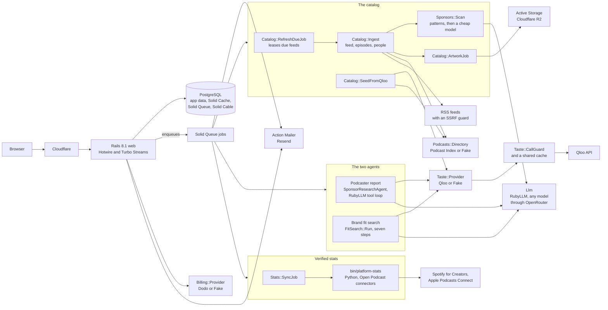

# Midrolo

**Where independent podcasts get sponsored.**

Midrolo is a marketplace for podcast sponsorship. Every show has a public page built from its own feed, with its
sponsor history and evidence. Podcasters claim and list their show free and verify their Spotify and Apple numbers by
inviting Midrolo. Brands find shows their customers love with an agent that uses Qloo's taste graph. Built for the
Qloo Agentic Hackathon.

- Live site: https://midrolo.com
- How we use Qloo: [docs/how-we-use-qloo.md](docs/how-we-use-qloo.md)
- Deploy guide: [docs/deploy.md](docs/deploy.md)
- License: AGPL-3.0 ([LICENSE](LICENSE))

## What it does

**The directory** (`/podcasts`)

- **A page for every show,** from its own RSS feed: episodes, the people it names, details, and the numbers with the
  source and date of each.
- **Sponsor history with evidence.** Sponsor reads, promo codes and offers found in episode notes, each quoting the
  show's own sentence and linking to its episode. Brand pages turn it around ("Podcasts Notion sponsors").
- **Search adds what's missing.** A show the catalog lacks is added from Podcast Index while you watch.
- **Remove this page** on every page, for anyone.

**For brands** (`/brand`)

- **The fit search agent.** Name a brand; seven steps, watched live, find it on Qloo, ask which podcasts its
  customers' tastes favor, score the catalog, add proof from the shows its competitors sponsor, check price and
  verified numbers, and rank the shows with reasons.
- **Saved shows** and **request a spot**: a thread with the show, no commission. A verified work email raises the
  daily limits.

**For podcasters** (`/shows`)

- **Claim your page, free:** through the feed's owner email, an email code, or a token in the show description.
- **The listing:** open to sponsors, a suggested rate card, open months, who you want, what you won't advertise.
- **Verified stats, "Invite Midrolo":** add Midrolo's stats account to your show in Spotify for Creators (Analytics
  access) or Apple Podcasts Connect (the Analyst role). Midrolo reads the numbers with its own account every day.
- **One inbox** for brand requests: accept, decline, block, report.
- **The sponsor research agent** (the paid toolkit): a Qloo taste profile of the show's audience, up to 50 brands
  ranked by fit with reasons, shows with a similar audience and the brands that sponsor them, pitch packs and a
  pipeline. A free **Snapshot** uses Qloo only, with no AI.

## Screenshots

Placeholders until the marketplace is deployed. Real screenshots go in `docs/screenshots/` and carry no credentials or
personal data.

| Screen | Status |
| --- | --- |
| Landing page | Placeholder: added after deploy |
| A podcast page with sponsor history and verified numbers | Placeholder: added after deploy |
| A brand's fit search, filling in live | Placeholder: added after deploy |
| Fit search results with proof | Placeholder: added after deploy |
| A podcaster's report, with similar shows | Placeholder: added after deploy |
| The Stats screen, Invite Midrolo | Placeholder: added after deploy |

## How it works

Every outside service sits behind an adapter with a Fake twin. Controllers, models and views only talk to the
adapters.



- **The catalog** (`app/services/catalog/`) reads each feed with conditional GET and adaptive polling, leases due
  feeds with `FOR UPDATE SKIP LOCKED`, paces each host, and stores artwork once per image hash. It was seeded from
  Qloo's podcast lists by genre (`catalog:seed`).
- **Sponsor detection** (`app/services/sponsors/`) scans episode notes with patterns, then a cheap model confirms
  candidates. A brand counts only if the notes name it, and the evidence is always the show's own sentence.
- **The brand side agent** (`app/services/fit_search/`) makes every Qloo call in Ruby, at most 10 a search, and logs
  each step to the live trace. Scoring is plain Ruby: taste 50, proof 25, price 15, trust 10.
- **The podcaster's agent** (`app/agents/sponsor_research_agent.rb`) plans the research and writes the reasons; its
  tools (`app/services/research/`) do the Qloo, directory and feed work. It is capped at 40 tool calls and 6 minutes.
  The save tools reject any brand the run never showed the model, and any number not in the data.
- **Verified stats** (`app/services/stats/`, `script/platform_stats.py`) run Open Podcast's connectors in a Python
  helper with Midrolo's own session on stdin only. A reading counts only when the inviter owns the claimed podcast
  and the platform's show matches it. Every number on a page carries its trust badge, source and date.
- **Conversations** (`app/services/conversations/`) never email an unclaimed show, never copy a brand's text into an
  email, and hold brands to daily limits until they verify a work email.
- **The Qloo client** (`app/services/taste/`) caches every answer, shares it across users, and asks the call guard
  before each live request. Details: [docs/how-we-use-qloo.md](docs/how-we-use-qloo.md).
- **The blog** (`/blog`) is the SEO growth channel: Markdown files in the repo, no database. See [Blog](#blog).

Stack: Ruby 3.4.12, Rails 8.1, PostgreSQL 16, Hotwire, importmap and Tailwind 4 (no Node build), Devise with Google
sign in, Solid Queue, Solid Cache, Solid Cable, Python 3.11 for the stats helper, MapLibre with OpenFreeMap tiles.

## Blog

The blog is how Midrolo grows through search. Each post answers a question independent podcasters search for, like
how to find a first sponsor or what to charge for an ad read, and ends with a free Snapshot and the sample reports.

To add a post, drop a Markdown file in `content/blog/` and deploy. The file name is the URL:
`content/blog/what-to-charge-for-a-midroll.md` is `/blog/what-to-charge-for-a-midroll`.

```markdown
---
title: What to charge for a midroll
description: The meta description, about 150 to 160 characters, shown in search results and link previews.
published_on: 2026-11-02
updated_on: 2026-11-09         # optional: the last real change
author: Midrolo                # optional: Midrolo by default
tags: [Pricing, Sponsorship]   # optional: shown on the post and used for related posts
draft: true                    # optional: hidden outside development
---
The post, in Markdown. Use ## for sections: three or more give the post a table of contents.
```

- **Drafts.** `draft: true`, or a `published_on` after today, hides a post everywhere but development, where it shows
  with a badge. A post deployed ahead of its date goes live on that date by itself.
- **Automatic.** Every post gets its share image (`/blog/<slug>/og.png`, 1200x630, drawn like the sample report
  cards), Open Graph and Twitter tags, JSON-LD (`BlogPosting` and `BreadcrumbList`), a sitemap entry and a place in
  the Atom feed at `/blog/feed.xml`. The header and footer link the blog once the first post is published.
- **Checks.** Broken front matter raises an error naming the file. `spec/copy/blog_posts_spec.rb` loads every post
  and fails on an em or en dash, or a description outside 70 to 160 characters. Raw HTML in a post is left out.

## Local setup

It runs with no API keys at all, in **demo mode**: the Fake adapters serve a made up podcast catalog, synthetic taste
data, and templated reasons, pitches and briefs. It makes no Qloo, Podcast Index or LLM calls and costs nothing.
Every page says "Demo mode: showing sample data (no API keys configured)."

You need Ruby 3.4.12, PostgreSQL 16 running locally (your user must be able to create databases) and libvips (for share
images and artwork).

```sh
git clone <this repo> midrolo
cd midrolo
bin/setup --skip-server   # bundle install, then bin/rails db:prepare (four local databases)
bin/dev                   # the app, the Tailwind watcher and the job worker (Procfile.dev)
```

Plain `bin/setup` does both: it ends by starting `bin/dev`.

Open http://localhost:3100 (bin/dev's default port; `PORT=3200 bin/dev` picks another).

- **Jobs.** Reports, brand searches, feed reads and sponsor scans run as background jobs, in the `bin/jobs` worker
  that `bin/dev` starts. Without bin/dev, `SOLID_QUEUE_IN_PUMA=1 bin/rails server` runs the worker inside the web
  server instead.
- **Sign in.** With `GOOGLE_CLIENT_ID` unset, the sign in page shows a **Dev sign in** card. Any name and email will
  do. It exists only in development.
- **A catalog.** `bin/rails "catalog:seed[16]"` links the demo taste data's podcasts to demo feeds and reads them.
  `bin/rails "catalog:add[Cold Case Cafe]"` adds one show by name, feed URL or Apple link.
- **The demo show.** Make yourself an admin (below), then `bin/rails demo:setup`: a fictional show with a published
  listing, for trying Request a spot.
- **Try the brand side.** Press "Find podcasts your customers love", name a brand, and watch the search.
- **Try the podcaster side.** Add a show from the demo catalog (try "Index Fund Mornings") and run a free Snapshot.
  A new account is on the free plan; start the server with `PROMO_PRO_UNTIL=2026-11-06` for the hackathon trial: 3
  shows, each with a Snapshot and a full report.
- **Sample reports.** `bin/rails samples:generate` runs the reports in `config/samples.yml` for `/samples`. With no
  keys set (demo mode) it uses the Fakes and costs $0.
- **The stats helper** is optional locally: [docs/deploy.md](docs/deploy.md) says how to make its Python venv.
  Without it, the Stats screen works and a fetch says the helper isn't installed.
- **Mail** opens in the browser at http://localhost:3100/letter_opener. The design system is at `/styleguide`.
- **Admin.** Make yourself an admin with
  `bin/rails runner 'User.find_by!(email: "you@example.com").update!(admin: true)'`, then open `/admin`. Setting
  `ADMIN_USERNAME` and `ADMIN_PASSWORD` adds a basic auth prompt on top.

The app reads its keys from the environment (there is no dotenv), so export them in the shell that starts the server.
Each key you add swaps one Fake for the real service.

## Environment variables

[.env.example](.env.example) lists every variable with what it does. The ones that matter most:

| Variable | What it turns on | Unset, outside production |
| --- | --- | --- |
| `QLOO_API_KEY` | Live Qloo taste data | Fake taste data |
| `PODCAST_INDEX_KEY`, `PODCAST_INDEX_SECRET` | Real podcast search | The demo catalog |
| `OPENROUTER_API_KEY` | The research agent, pitches, sponsor checks and brand briefs | Templated text, patterns only |
| `LLM_PROVIDER`, `LLM_AGENT_MODEL`, `LLM_PITCH_MODEL`, `LLM_CHEAP_MODEL` | Provider and model choice | `openrouter`, `z-ai/glm-5.3`, `deepseek/deepseek-v4.1-flash` |
| `GOOGLE_CLIENT_ID`, `GOOGLE_CLIENT_SECRET` | Google sign in | Dev sign in |
| `ACTIVE_RECORD_ENCRYPTION_*` (three keys) | Encrypted owner emails, codes and stats sessions | Fixed development keys |
| `MIDROLO_SPOTIFY_EMAIL`, `MIDROLO_APPLE_EMAIL` | The address podcasters invite for verified stats | stats@midrolo.com |
| `BILLING_MODE` | `waitlist`, `test` or `live` | `waitlist` |
| `DODO_API_KEY`, `DODO_WEBHOOK_SECRET` | Dodo checkout and webhooks | The Fake checkout |
| `PROMO_PRO_UNTIL` | The hackathon trial's last day | No trial |

Production has no demo mode. It refuses to boot without `QLOO_API_KEY`, `PODCAST_INDEX_KEY`, `PODCAST_INDEX_SECRET`,
the encryption keys, an absolute `APP_URL` and the rest of the required set ([docs/deploy.md](docs/deploy.md)).

**Billing** starts on the founding member waitlist. Listing a show is free and stays free. Live payments stay off until
an admin sets Qloo's cost per call and every paid plan keeps at least a 60% margin with every cap used
(`app/services/billing/margins.rb`).

## Tests

```sh
bin/rails db:test:prepare
bundle exec rspec spec/docs_spec.rb   # one file
bundle exec rspec                     # the whole suite
bin/ci                                # setup, RuboCop, bundler-audit, importmap audit, Brakeman, then the specs
python3 -m unittest discover -s test/python   # the stats helper, with its venv (docs/deploy.md)
```

`SKIP_NETWORK=1` leaves out the specs that need the internet, and `HEADFUL=1` shows the browser in system specs.
Specs never call Qloo, an LLM, Spotify or Apple: the Qloo client is tested against synthetic fixtures in
`spec/fixtures/qloo/`, and the stats helper against hand written payloads. Operators with access to the project's test
server can run the suite there with `bin/remote-rspec` ([docs/testing.md](docs/testing.md)), and
`REMOTE_RSPEC=1 bin/ci` runs its specs that way.

## Deploy

Production is a Coolify project on our own server, with Cloudflare in front. The full guide, from encryption keys and
the stats helper to the catalog seed and backups, is [docs/deploy.md](docs/deploy.md). To run it without Coolify, as
one Docker Compose stack, see [docs/self-hosting.md](docs/self-hosting.md).

## More docs

- [docs/how-we-use-qloo.md](docs/how-we-use-qloo.md): every Qloo call on both sides, a redacted walkthrough and the
  limitations
- [docs/devpost.md](docs/devpost.md): the submission text
- [docs/judging.md](docs/judging.md): the judge's walk and the submission checklist
- [docs/handoff.md](docs/handoff.md): from keys to judging, in order
- [docs/live-smoke.md](docs/live-smoke.md): the live Qloo shape check
- [docs/testing.md](docs/testing.md): local and remote test runs
- [docs/design.md](docs/design.md): the product design and decisions

## Data and credits

- Taste data from [Qloo](https://www.qloo.com). Audiences are modeled from taste data, not measured. No Qloo response
  data is committed to this repo.
- Podcast discovery through [Podcast Index](https://podcastindex.org). Show pages are built from each show's own RSS
  feed.
- Verified Spotify and Apple Podcasts stats are read with [Open Podcast](https://openpodcast.app)'s MIT licensed
  connectors, [spotify-connector](https://github.com/openpodcast/spotify-connector) and
  [apple-connector](https://github.com/openpodcast/apple-connector), signed in as Midrolo's own accounts, which
  podcasters invite to their show.
- Map tiles from [OpenFreeMap](https://openfreemap.org), drawn with MapLibre GL JS.

## License

[AGPL-3.0](LICENSE). Run it, change it and share it. If you host a changed version, share your source too.
