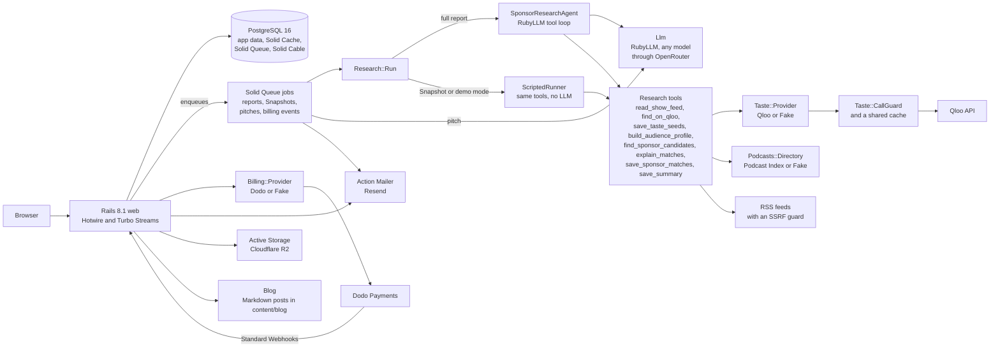

# Midrolo

**Find sponsors who already love your listeners.**

Midrolo is a sponsor research agent for independent podcasters. It builds a Qloo taste profile of a show's audience,
ranks the brands that fit, writes the pitch and publishes a media kit. Built for the Qloo Agentic Hackathon.

- Live site: https://midrolo.com
- How we use Qloo: [docs/how-we-use-qloo.md](docs/how-we-use-qloo.md)
- Deploy guide: [docs/deploy.md](docs/deploy.md)
- License: AGPL-3.0 ([LICENSE](LICENSE))

## What it does

- **Taste profile.** What people with the show's taste love more than most: brands, podcasts and taste tags.
- **Leans and places.** Age and gender leans, modeled from Qloo taste data, and a map of where that taste is strongest.
- **Ranked sponsors.** Up to 50 brands, each with a fit score, a reach tier (easy yes, realistic, long shot) and a
  one line reason.
- **Proven sponsors.** Brands already sponsoring similar shows, found in those shows' own RSS feeds.
- **Pitch pack.** An email, three ad read angles, an offer priced from a rate card, and a follow up.
- **Media kit.** A public page a host sends to brands, published only after the host proves they own the show.
- **Pipeline.** Track each brand from saved to won.

A free **Snapshot** uses Qloo only, with no AI. The full **agent report** adds the research agent.

## Screenshots

Placeholders until the site is deployed. Real screenshots go in `docs/screenshots/` and carry no credentials or
personal data.

| Screen | Status |
| --- | --- |
| Landing page | Placeholder: added after deploy |
| A report, filling in live | Placeholder: added after deploy |
| Sponsor matches | Placeholder: added after deploy |
| Pitch pack | Placeholder: added after deploy |
| Public media kit | Placeholder: added after deploy |

## How it works

Every outside service sits behind an adapter with a Fake twin. Controllers, models and views only talk to the
adapters.



- **The agent** (`app/agents/sponsor_research_agent.rb`) plans the research. It picks seeds, brand categories and
  which matches to keep, and writes the reasons. It is capped at 40 tool calls and 6 minutes.
- **The tools** (`app/services/research/`) do the Qloo, directory and feed work in Ruby and hand back short
  summaries. Scoring and tiers are plain Ruby (`config/scoring.yml`), so they are stable and explainable.
- **Provenance.** The save tools reject any brand the run never showed the model, and any number not in the data.
- **The Qloo client** (`app/services/taste/`) caches every answer, shares it across users, and asks the call guard
  before each live request. Details: [docs/how-we-use-qloo.md](docs/how-we-use-qloo.md).
- **The blog** (`/blog`) is the SEO growth channel: Markdown files in the repo, no database. See [Blog](#blog).

Stack: Ruby 3.4.12, Rails 8.1, PostgreSQL 16, Hotwire, importmap and Tailwind 4 (no Node build), Devise with Google
sign in, Solid Queue, Solid Cache, Solid Cable, MapLibre with OpenFreeMap tiles.

## Blog

The blog is how Midrolo grows through search. Each post answers a question independent podcasters search for, like
how to find a first sponsor or what to charge for an ad read, and ends with a free Snapshot and the sample reports.

To add a post, drop a Markdown file in `content/blog/` and deploy. The file name is the URL:
`content/blog/what-to-charge-for-a-midroll.md` is `/blog/what-to-charge-for-a-midroll`.

```markdown
---
title: What to charge for a midroll
description: The meta description, about 150 to 160 characters, shown in search results and link previews.
published_on: 2026-11-02
updated_on: 2026-11-09         # optional: the last real change
author: Midrolo                # optional: Midrolo by default
tags: [Pricing, Sponsorship]   # optional: shown on the post and used for related posts
draft: true                    # optional: hidden outside development
---
The post, in Markdown. Use ## for sections: three or more give the post a table of contents.
```

- **Drafts.** `draft: true`, or a `published_on` after today, hides a post everywhere but development, where it shows
  with a badge. A post deployed ahead of its date goes live on that date by itself.
- **Automatic.** Every post gets its share image (`/blog/<slug>/og.png`, 1200x630, drawn like the sample report
  cards), Open Graph and Twitter tags, JSON-LD (`BlogPosting` and `BreadcrumbList`), a sitemap entry and a place in
  the Atom feed at `/blog/feed.xml`. The header and footer link the blog once the first post is published.
- **Checks.** Broken front matter raises an error naming the file. `spec/copy/blog_posts_spec.rb` loads every post
  and fails on an em or en dash, or a description outside 70 to 160 characters. Raw HTML in a post is left out.

## Local setup

It runs with no API keys at all, in **demo mode**: the Fake adapters serve a made up podcast catalog, synthetic taste
data, and templated reasons and pitches. It makes no Qloo, Podcast Index or LLM calls and costs nothing. Every page
says "Demo mode: showing sample data (no API keys configured)."

You need Ruby 3.4.12, PostgreSQL 16 running locally (your user must be able to create databases) and libvips (for share
images and kit photos).

```sh
git clone <this repo> midrolo
cd midrolo
bin/setup --skip-server   # bundle install, then bin/rails db:prepare (four local databases)
bin/dev                   # the app, the Tailwind watcher and the job worker (Procfile.dev)
```

Plain `bin/setup` does both: it ends by starting `bin/dev`.

Open http://localhost:3100 (bin/dev's default port; `PORT=3200 bin/dev` picks another).

- **Jobs.** Reports, Snapshots and pitches run as background jobs, in the `bin/jobs` worker that `bin/dev` starts.
  Without bin/dev, `SOLID_QUEUE_IN_PUMA=1 bin/rails server` runs the worker inside the web server instead.
- **Sign in.** With `GOOGLE_CLIENT_ID` unset, the sign in page shows a **Dev sign in** card. Any name and email will
  do. It exists only in development.
- **Try it.** Add a show from the demo catalog (try "Index Fund Mornings") and run a free Snapshot.
- **A full report.** A new account is on the free plan. Start the server with `PROMO_PRO_UNTIL=2026-11-06` for one
  promo report, or with `JUDGE_CODE=letmein` and enter that code on the account page for judge access.
- **Sample reports.** `bin/rails samples:generate` runs the reports in `config/samples.yml` for `/samples`. With no
  keys set (demo mode) it uses the Fakes and costs $0. The file names demo catalog shows (`fake-1` to `fake-3`) until
  real Podcast Index ids replace them.
- **Mail** opens in the browser at http://localhost:3100/letter_opener. The design system is at `/styleguide`.
- **Admin.** Make yourself an admin with
  `bin/rails runner 'User.find_by!(email: "you@example.com").update!(admin: true)'`, then open `/admin`. Setting
  `ADMIN_USERNAME` and `ADMIN_PASSWORD` adds a basic auth prompt on top.

The app reads its keys from the environment (there is no dotenv), so export them in the shell that starts the server.
Each key you add swaps one Fake for the real service.

## Environment variables

[.env.example](.env.example) lists every variable with what it does. The ones that matter most:

| Variable | What it turns on | Unset, outside production |
| --- | --- | --- |
| `QLOO_API_KEY` | Live Qloo taste data | Fake taste data |
| `PODCAST_INDEX_KEY`, `PODCAST_INDEX_SECRET` | Real podcast search | The demo catalog |
| `OPENROUTER_API_KEY` | The research agent and pitch writer | Templated reasons and pitches |
| `LLM_PROVIDER`, `LLM_AGENT_MODEL`, `LLM_PITCH_MODEL` | Provider and model choice | `openrouter`, `z-ai/glm-5.3` |
| `GOOGLE_CLIENT_ID`, `GOOGLE_CLIENT_SECRET` | Google sign in | Dev sign in |
| `BILLING_MODE` | `waitlist`, `test` or `live` | `waitlist` |
| `DODO_API_KEY`, `DODO_WEBHOOK_SECRET` | Dodo checkout and webhooks | The Fake checkout |
| `JUDGE_CODE`, `PROMO_PRO_UNTIL` | Judge access, the hackathon promo | Neither |

Production has no demo mode. It refuses to boot without `QLOO_API_KEY`, `PODCAST_INDEX_KEY`, `PODCAST_INDEX_SECRET`,
an absolute `APP_URL` and the rest of the required set ([docs/deploy.md](docs/deploy.md)).

**Billing** starts on the founding member waitlist. Live payments stay off until an admin sets Qloo's cost per call and
every paid plan keeps at least a 60% margin with every cap used (`app/services/billing/margins.rb`).

## Tests

```sh
bin/rails db:test:prepare
bundle exec rspec spec/docs_spec.rb   # one file
bundle exec rspec                     # the whole suite, about 12 minutes on a laptop
bin/ci                                # setup, RuboCop, bundler-audit, importmap audit, Brakeman, then the specs
```

`SKIP_NETWORK=1` leaves out the specs that need the internet, and `HEADFUL=1` shows the browser in system specs.
Specs never call Qloo or an LLM: the Qloo client is tested against synthetic fixtures in `spec/fixtures/qloo/`.
Operators with access to the project's test server can run the suite there with `bin/remote-rspec`
([docs/testing.md](docs/testing.md)), and `REMOTE_RSPEC=1 bin/ci` runs its specs that way.

## Deploy

Production is one Docker Compose stack behind a Traefik proxy, with Cloudflare DNS in front. The full guide, from DNS
to backups and restores, is [docs/deploy.md](docs/deploy.md).

## More docs

- [docs/how-we-use-qloo.md](docs/how-we-use-qloo.md): every Qloo endpoint, a redacted walkthrough and the limitations
- [docs/live-smoke.md](docs/live-smoke.md): the live Qloo shape check
- [docs/testing.md](docs/testing.md): local and remote test runs
- [docs/design.md](docs/design.md): the product design and decisions

## Data and credits

- Taste data from [Qloo](https://www.qloo.com). Audiences are modeled from taste data, not measured. No Qloo response
  data is committed to this repo.
- Podcast data from [Podcast Index](https://podcastindex.org).
- Map tiles from [OpenFreeMap](https://openfreemap.org), drawn with MapLibre GL JS.

## License

[AGPL-3.0](LICENSE). Run it, change it and share it. If you host a changed version, share your source too.
