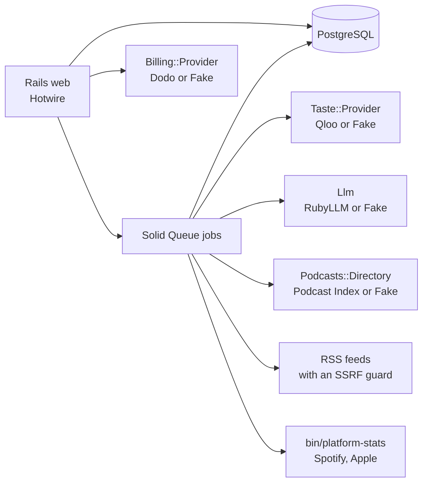

# Midrolo

**Where independent podcasts get sponsored.**

Midrolo is a podcast sponsorship marketplace that matches brands and shows by taste, using Qloo's taste graph.

- **Brands find podcasts.** Name your brand, and an agent finds the shows your customers love, with proof, price and
  verified numbers for each.
- **Podcasters find sponsors.** Claim your show's page for free, verify your numbers, and get a ranked list of brands
  whose customers share your audience's taste.

Live site: **https://midrolo.com**

Video: [Midrolo in 60 seconds](https://youtu.be/25Gbe3DYwXk)

Built for the Qloo Agentic Hackathon.

## How it uses Qloo

Qloo answers one question for both sides: what do people with this taste love, more than most people do? Every call
is a GET to Qloo's API with the key in a header (`app/services/taste/providers/qloo.rb`).

| Endpoint | What Midrolo uses it for |
| --- | --- |
| `/search` | Find a show or a brand on Qloo, and check that a sponsor name found in a feed is a real brand. |
| `/v2/tags` | Turn topics and show or brand categories into Qloo taste tags. |
| `/v2/insights`, `filter.type=urn:entity:brand` | Brands an audience loves, overall and per category, and a taste score for each candidate brand. |
| `/v2/insights`, `filter.type=urn:entity:podcast` | Podcasts a brand's customers love, shows with a similar audience, taste scores for catalog shows, and the first catalog seed, genre by genre. |
| `/v2/insights`, `filter.type=urn:tag` | An audience's taste tags. Each reason names the tags a show and a brand share. |
| `/v2/insights`, `filter.type=urn:demographics` | How an audience leans by age and gender. |
| `/v2/insights`, `filter.type=urn:heatmap` | Where a taste is strongest, drawn as a map. |
| `/v2/analysis/compare` | Built, and off by default: our live probe found no shared tags, so reasons use the tag overlap instead. |

Qloo is called only when someone starts a search or a report (or an admin seeds the catalog), never on a page view.
Answers are cached and shared across users, and a call guard holds every run to a cap (10 uncached calls for a brand
search) and the whole app to a daily limit. The full write up, with every call and its limits, is
[docs/how-we-use-qloo.md](docs/how-we-use-qloo.md).

No Qloo response data is committed to this repo: the specs use small synthetic fixtures (`spec/fixtures/qloo/`).

## Main features

- **The brand fit search.** Name a brand and watch seven steps fill in live: find the brand on Qloo, ask which podcasts
  its customers love, score the catalog's shows in its categories, check which brands like it already sponsor them,
  check rates and verified numbers, then rank the shows and say why each fits. Scoring is plain Ruby: taste 50,
  proof 25, price 15, trust 10.
- **Sponsor history from show notes.** Every show has a public page built from its own RSS feed. Midrolo reads the
  episode notes for sponsor reads, promo codes and offers, and shows each sponsor with the show's own sentence and a
  link to the episode. Brand pages turn it around: "Podcasts Notion sponsors".
- **Verified stats from Spotify and Apple.** A podcaster invites Midrolo's stats account to their show in Spotify for
  Creators or Apple Podcasts Connect. Midrolo then reads the numbers itself every day. Every number on a page shows
  where it came from, when, and whether it was verified.
- **The inbox.** A brand requests a spot, and the show's owner can accept, decline, block or report. No commission.
  Midrolo never emails a show that hasn't been claimed.
- **The podcaster's sponsor report.** An AI agent picks the seeds that stand for the audience, asks Qloo, and ranks up
  to 50 brands by fit, with reasons. It can only name brands that Qloo returned in that run. A free Snapshot gives the
  taste profile, the map and brand matches without the AI.

## Tech stack

- Ruby 3.4.12, Rails 8.1, PostgreSQL 16
- Hotwire (Turbo and Stimulus), importmap and Tailwind 4, with no Node build
- Solid Queue, Solid Cache and Solid Cable, all on Postgres
- Devise with Google sign in
- RubyLLM for the AI parts, through OpenRouter, so the model is one setting
- A Python 3.11 helper for the verified stats, using Open Podcast's connectors
- MapLibre with OpenFreeMap tiles for the maps
- Active Storage on Cloudflare R2, Resend for mail, Dodo Payments for billing
- Puma behind Thruster, in Docker
- RSpec with Cuprite (headless Chrome) for tests

Every outside service sits behind an adapter with a Fake twin, so the app runs with no keys at all:



## Local setup

With no API keys set, Midrolo runs in **demo mode**: the Fake adapters serve a made up podcast catalog, synthetic
taste data and templated text. It makes no Qloo, Podcast Index or AI calls, and costs nothing.

You need Ruby 3.4.12, PostgreSQL 16 running locally (your user must be able to create databases) and libvips.

```sh
git clone https://github.com/inventionsbyhamid/midrolo.git
cd midrolo
bin/setup --skip-server   # bundle install, then bin/rails db:prepare
bin/dev                   # the web server, the Tailwind watcher and the job worker (Procfile.dev)
```

Plain `bin/setup` does both steps. Then open http://localhost:3100 (`PORT=3200 bin/dev` picks another port).

- **Sign in.** With `GOOGLE_CLIENT_ID` unset, the sign in page shows a **Dev sign in** card. Any name and email will
  do. It exists only in development.
- **A catalog.** `bin/rails "catalog:seed[16]"` fills the directory from the demo data.
  `bin/rails "catalog:add[Cold Case Cafe]"` adds one show by name, feed URL or Apple link.
- **Admin.** `bin/rails runner 'User.find_by!(email: "you@example.com").update!(admin: true)'`, then open `/admin`.
- **The demo show.** Once you're an admin, `bin/rails demo:setup` makes a fictional show to request a spot on.
- **Try it.** Press "Find podcasts your customers love" and name a brand. Or add a show from the demo catalog (try
  "Index Fund Mornings") and run a free Snapshot.
- **Mail** opens at http://localhost:3100/letter_opener.

The app reads keys from the environment (there is no dotenv). Each key you set swaps one Fake for the real service.
[.env.example](.env.example) lists every variable and what it does.

## Tests

```sh
bin/rails db:test:prepare
bundle exec rspec                               # the whole suite
bin/ci                                          # RuboCop, the audits, Brakeman, then the suite
python3 -m unittest discover -s test/python     # the stats helper
```

`SKIP_NETWORK=1` leaves out the specs that need the internet, and `HEADFUL=1` shows the browser in system specs.
Specs never call Qloo, an AI model, Spotify or Apple. GitHub Actions runs the suite and the checks on every push. To run the
suite on a bigger machine over ssh, see `bin/remote-rspec` in [docs/testing.md](docs/testing.md).

## Self hosting

[docs/self-hosting.md](docs/self-hosting.md) runs Midrolo as one Docker Compose stack behind a Traefik proxy, with
nightly backups to R2. midrolo.com itself runs as a Coolify project: [docs/deploy.md](docs/deploy.md). Production has
no demo mode and won't boot without its keys.

## More docs

- [docs/how-we-use-qloo.md](docs/how-we-use-qloo.md): every Qloo call, a walkthrough and the limitations
- [docs/design.md](docs/design.md): the product design and the decisions behind it
- [docs/testing.md](docs/testing.md): local and remote test runs
- [docs/live-smoke.md](docs/live-smoke.md): the live check of Qloo's response shapes

## Credits

- Taste data from [Qloo](https://www.qloo.com). Audiences are modeled from taste data, not measured.
- Podcast discovery through [Podcast Index](https://podcastindex.org). Show pages come from each show's own feed.
- Verified stats use [Open Podcast](https://openpodcast.app)'s MIT licensed
  [spotify-connector](https://github.com/openpodcast/spotify-connector) and
  [apple-connector](https://github.com/openpodcast/apple-connector).
- Map tiles from [OpenFreeMap](https://openfreemap.org).

## License

[AGPL-3.0](LICENSE). Run it, change it and share it. If you host a changed version, share your source too.
